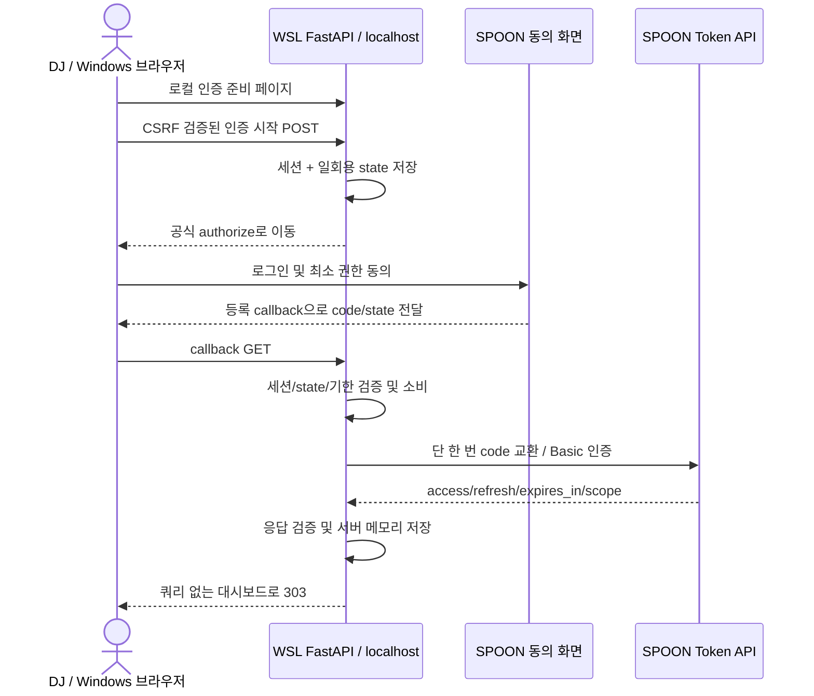

# K2.0 — 로컬 OAuth 구현 설계안

이 문서는 SPOON의 추가 사양이 아니라 프로젝트의 구현 제안이다. 조사 근거는 [OAuth 조사](k2-0-spoon-oauth-research.md)를 참고한다. 이 단계에서 인증 API, 설정 값, DB 스키마를 추가하거나 실제 인증을 실행하지 않았다.

## 적용 범위와 전제

단일 DJ, 개인 PC, WSL FastAPI, Windows 기본 브라우저를 사용한다. 기존 health/status와 SQLite 데이터는 보존한다. Spoon 공식 HTTPS 통신만 허용하고 클라우드 중계, 터널, LLM, 다른 DJ 기능은 추가하지 않는다. 대시보드 자체는 외부 호출 없이 유지하며 향후 OAuth만 공식 네트워크 접근이 필요하다.

개인 사용자가 자기 앱 자격 증명을 로컬 서버에 보관하는 모델을 전제로 한다. Secret을 프로그램 배포본에 포함하지 않는다. 이것만으로 네이티브 앱의 confidential client 적합성을 입증하지는 않는다. [RFC 8252 §8.5](https://www.rfc-editor.org/rfc/rfc8252.html#section-8.5)의 배포형 공유 Secret 한계를 고려하고, public client/PKCE 지원 여부를 Spoon에 확인한다. [RFC 9700 §2.1.1](https://www.rfc-editor.org/rfc/rfc9700.html#section-2.1.1)은 PKCE를 보안 기준으로 다루므로, state만으로 PKCE와 동일한 보호를 제공한다고 주장하지 않는다.

## 주소와 설정 제안

- listen 주소는 `127.0.0.1:8000`, 단일 워커. `0.0.0.0`은 사용하지 않는다.
- callback 후보는 `http://localhost:8000/auth/spoon/callback`. 등록·authorize·token 요청에 동일 문자열을 사용한다. 포트 임의 변경은 하지 않는다.
- localhost와 127.0.0.1은 다른 origin/쿠키 호스트다. 대시보드의 로그인 안내는 먼저 localhost의 로컬 인증 준비 페이지로 이동시키고, 그 호스트에서만 인증 세션을 만든다. 미확인 origin을 쿠키 공유로 우회하지 않는다.
- Windows → WSL localhost 전달은 실제로 검증한다. IPv6 localhost 실패 때 리디렉션을 무단으로 IP 주소로 바꾸지 않는다.
- 향후 설정 이름: SPOON_CLIENT_ID, SPOON_CLIENT_SECRET, SPOON_REGION, SPOON_REDIRECT_URI. 모두 제안이며 이번 .env/.env.example에는 추가하지 않는다.
- 지역별 고정 allowlist로 authorize/token/revoke 주소를 결정한다. 사용자 입력 URL을 외부 토큰 서버 주소로 사용하지 않는다. TLS 검증 유지, redirect 자동 추종 금지, 요청 제한시간 설정.
- Client ID 형식, Secret 존재, redirect 정확한 값, 지역, scope를 시작 전에 검증한다. 누락 시 not_configured이며 앱 health는 유지한다.

## 인증 흐름

이 다이어그램의 공식 동작은 [사용자 동의](https://developers.spooncast.net/docs/getting-started/user-authorization)와 [토큰](https://developers.spooncast.net/docs/api-reference/tokens)에 근거한다. 세션/CSRF/저장은 프로젝트 정책이다. PKCE가 확인되면 S256 challenge와 verifier를 같은 거래에 결합한다; 현재 지원을 가정해 보내지는 않는다.

- pending 거래는 메모리에 한 개만 유지하며 임의 state를 브라우저 세션에 결합한다. 생성 시각·redirect·scope·사용 여부를 저장한다. 로컬 거래 기한은 예를 들어 5분이며, 공식 code의 60초 유효시간과 구분한다.
- 세션 쿠키는 HttpOnly, SameSite=Lax, 짧은 만료, localhost 전용이다. HTTP 개발 콜백에서는 Secure를 사용할 수 없는 한계를 명시한다. 운영 HTTPS 모드가 생기면 Secure가 필수다.
- 시작/해제 POST는 CSRF token과 정확한 Origin을 검증한다. Host allowlist도 적용하고 와일드카드 CORS를 열지 않는다. loopback만으로 웹사이트의 CSRF나 로컬 악성 프로세스를 막는다고 가정하지 않는다.
- callback은 state 누락·불일치·만료·세션 불일치·중복 query·code/error 동시 존재를 거절한다. state와 세션 비교 후 교환 전에 거래를 원자적으로 소비한다. 중복 callback은 재교환하지 않는다.
- 거절/오류 callback에서도 state를 먼저 검사한다. redirect 목적지는 고정하고 return URL 입력을 받지 않는다.
- code 교환은 자동 retry 없이 한 번만 수행한다. 타임아웃으로 발급 여부가 불명확하면 거래를 실패로 종료하고 새 동의 흐름을 안내한다.
- 응답 필드·Bearer 타입·양수 expires_in·필요 scope를 확인한다. 브라우저에는 성공 여부만 보내며 code/token을 응답 HTML이나 저장소로 전달하지 않는다. 임의 JWT decode로 DJ 식별을 수행하지 않는다.

## 토큰 저장 및 갱신

K2.1 초기 저장소는 서버 메모리로 제한하는 것을 권장한다. 재시작 시 재동의 화면을 다시 거치는 제약이 있다. 일반 SQLite에 평문 토큰을 넣거나 .env를 토큰 갱신 파일로 사용하는 방식은 채택하지 않는다.

영속화 단계는 별도 결정이다. OS 보안 저장소의 WSL 사용 가능 여부를 검증한 후, 그 저장소에 토큰을 직접 보관하거나 암호화 키를 보관하고 Git 제외된 별도 auth SQLite에 암호문을 저장한다. 키를 암호문과 같은 디렉터리/.env에 두는 방식은 충분한 보호가 아니다. 가용한 보안 저장소가 없으면 메모리 모드에 머무르고 자동으로 평문 fallback하지 않는다. 토큰 메타데이터는 단일 슬롯의 scope, 발급시각, access 만료시각, 세대 번호로 제한한다. 데이터 디렉터리 0700·파일 0600은 보조 수단이며 암호화를 대체하지 않는다. 후원 DB와 분리하고 원본 데이터는 삭제하지 않는다.

갱신 설계:

1. 실제 expires_in을 사용하고 수명의 약 10%를 여유(최대 5분)로 두는 방식을 제안한다. 1시간 전이라는 문서 예시를 상수로 적용하지 않는다. 실행 중에는 monotonic 시간을 이용한다.
2. 전체 프로세스에서 갱신 작업을 직렬화한다. workers=1을 전제로 하고 다중 프로세스 갱신은 지원하지 않는다. 새 토큰을 받은 작업만 저장 세대를 갱신한다.
3. 새 access/refresh/scope/만료를 하나의 교체 단위로 저장한 뒤 이후 호출에 사용한다. 영속 저장에서는 트랜잭션으로 교체하되, 원격 회전과 로컬 저장을 하나의 원자적 트랜잭션으로 만들 수 없다는 crash window를 인정한다.
4. 응답 유실·저장 실패 시 이전 refresh로 무한 retry하지 않는다. 재인증 필요 상태로 전환한다. 공식 refresh 재사용 세부 사양이 확인되기 전에는 보수적으로 적용한다.
5. scope가 줄면 해당 기능을 중단한다. 인증됨과 방송 연결됨을 구분하며 인증 성공만으로 후원 수신/캡처가 동작한다고 표시하지 않는다.
6. invalid_grant는 재인증, invalid_client는 설정 오류로 표시한다. 원문 error_description이나 response body를 브라우저·로그로 그대로 전달하지 않는다.

## 로그 마스킹과 인증 해제

Authorization, Client Secret, code, state, access/refresh token, Cookie/Set-Cookie는 로그에서 전량 제거한다. 부분 토큰이나 callback 전체 URL도 남기지 않는다. callback query는 Uvicorn access log에도 실릴 수 있으므로 구현 전에 서버 접근 로그를 query 없는 allowlist 형식으로 바꾼다. 로거·HTTP client 예외·debug traceback에도 원문 request/response를 기록하지 않는다. 브라우저에는 일반 오류 코드만 제공한다.

callback 응답은 Cache-Control: no-store, Referrer-Policy: no-referrer와 함께 고정 로컬 화면으로 즉시 303 이동한다. 외부 리소스를 넣지 않는다. 브라우저 히스토리에 일회용 code가 남을 가능성을 완전히 없앤다고 주장하지 않는다. 단기·일회용 처리와 기록 최소화를 함께 적용한다.

인증 해제는 CSRF 검증된 명시적 POST로 진행한다. 갱신을 중지하고 미래 이벤트 연결을 닫은 뒤 refresh revoke를 시도한다. 폐기 확인 시 메모리/영속 토큰과 pending 세션만 지우고 후원·캡처 기록은 보존한다. 네트워크 실패 시 서버측 폐기 미확인 상태를 구분한다. 사용자가 선택하는 로컬 삭제는 가능하되 원격 토큰이 무효화됐다고 표시하지 않는다. revoke가 성공해도 DJ 동의는 남으므로 UI는 로컬 인증 해제와 Spoon 연동 동의 철회를 구분한다. Spoon 측 동의 철회 화면 경로는 미확인으로 둔다.

## 향후 모듈 및 테스트 설계

구현 파일 후보는 spoon/oauth.py(공식 client), spoon/auth_service.py(state/갱신), spoon/token_store.py(메모리 저장), web/auth_routes.py(로컬 route)이다. 현 DB와 테스트는 유지하고 설정·시계·HTTP transport·저장소를 주입한다. 런타임 HTTP client를 만들 경우 현재 dev 전용 httpx를 런타임 의존성으로 이동하는 작업도 필요하다. 이번 단계에서는 의존성 변경이 없다.

K2.1 mock 검증 항목:

- 실제 .env를 읽지 않는 테스트, 기본 not_configured, 설정 누락과 지역/redirect 검증
- 임의 state의 세션 결합, 누락/변조/만료/재전송·CSRF·Host 거절
- code 1회 교환, 유실 시 retry 없음, error callback 안전 처리
- expires_in·scope 검증, 단일 갱신·회전 저장·실패시 재인증
- 토큰/Secret이 API·로그·브라우저에 없는지 sentinel 검사
- mock revoke 성공·실패, 로컬 기록 보존
- 기존 health/status/dashboard 및 SQLite 테스트 전체 유지

실제 계정 테스트는 앱 승인, callback 등록과 Windows↔WSL 도달, PKCE/public client 답변, 저장 모드를 확인하고 이후 명시적으로 요청한 단계에서 진행한다. 이 문서는 그 테스트가 완료됐다는 근거가 아니다.

## K2.1 진행 판단

오프라인 기반 구현은 가능하다. 실제 OAuth 운영이 준비됐다고 판단할 수는 없다. PKCE 미확인 상태를 숨기거나, 앱 승인 없이 API가 열려 있다고 가정하거나, 자동 인증을 위해 토큰을 평문 저장하지 않는다. 다음 작업은 공식 미확인 항목 해소와 mock 기반 인증 구조 구현을 구분해 요청하는 것이 적합하다.
