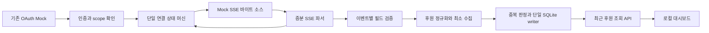

# K3.0 — 로컬 후원 이벤트 처리 설계안

이 문서는 **프로젝트 정책 제안**이다. 공식 필드/연결 근거는 [조사 문서](k3-0-sse-research.md)에 있다. SQL·타입·API 경로는 초안이며 이번 단계에서 실행하거나 기존 코드를 변경하지 않았다.

## 구성과 책임



- EventSource 인터페이스: open/async byte iterator/close를 주입한다. mock은 메모리 fixture만 사용하며 외부 소켓을 차단한다. 실제 SPOON HTTP 구현은 추가하지 않는다.
- parser는 HTTP·OAuth·DB를 모른다. 바이트를 받아 frame(event,data,explicit_id,retry_hint)로 변환한다. controller는 상태 코드/헤더, parser가 전달한 종료 사유, 시계·취소를 다룬다.
- donation handler만 최소 필드를 저장한다. 다른 이벤트는 검증용 분기만 두고 기본 저장하지 않는다. writer는 커밋 완료 후 화면에 기록을 공개한다.
- 연결 task, DB writer, bounded queue는 각 하나다. 대시보드 탭마다 외부 연결을 만들지 않는다. future screenshot side effect는 DB 성공 전에 실행하지 않는다.
- 후보 모듈: spoon/sse_source.py, sse_parser.py, event_models.py, stream_service.py, donation_repository.py. 현재 코드에는 파일을 만들지 않는다.

## 증분 파서와 데이터 한계

UTF-8 증분 decoder, LF/CRLF/CR, 빈 줄 프레임 경계, comment, 여러 data 줄의 개행 결합, BOM, event/id/retry 필드의 표준 의미를 처리한다. 기준: [WHATWG SSE 표준](https://html.spec.whatwg.org/multipage/server-sent-events.html#event-stream-interpretation). 이 표준이 SPOON의 replay 지원을 추가로 보장하는 것은 아니다.

프레임마다 명시적으로 받은 id와 이전 last-id를 구분한다. 표준의 last-id 상속값을 모든 후원의 고유 ID로 쓰면 id 없는 후원을 중복으로 오인할 수 있다. 마지막 미완성 프레임은 DB에 저장하지 않고 gap 지표만 기록한다. comment는 후원으로 전달하지 않는다. 알 수 없는 이벤트/추가 JSON 필드는 무시하되 필수 필드 누락과 잘못된 타입은 거절한다. 손상된 단일 JSON은 다른 완성 프레임까지 중단시키지 않으며 원문을 로그에 남기지 않는다.

제안 초기 한도: 프레임64KiB, JSON 깊이 제한, 큐256개, 오류 본문8KiB. 이는 공급자 한도가 아니다. 제한 초과는 명시적 경고/수집 중단 또는 해당 프레임 제외와 gap 처리로 기록하며 조용히 버리지 않는다. 실제 상한 확인 전까지 큰 원문을 임의로 잘라 유효한 후원으로 저장하지 않는다. retry 필드 수용 여부는 표준 파싱과 별개로 controller가 bounded 정책을 결정하며, 미래 서버 hint를 공식 고정 재시도값으로 만들지 않는다.

## 방송 상태 머신과 재연결 제안

| 로컬 상태 | 진입 / 다음 동작 |
|---|---|
| DISABLED | 기본 비활성 또는 인증 미준비 |
| AUTH_REQUIRED | 인증 실패·해제; source 정지 |
| CONNECTING | 단일 연결 시도 |
| LIVE | 연결과 frame 수신 정상; 마지막 수신시각 갱신 |
| WAITING | 미방송/방송 종료; 즉시 reconnect 없이 다음 회차 대기 |
| BACKOFF | EOF·네트워크·일시 서버 장애; 지연 후 CONNECTING |
| REFRESHING | 만료 신호; OAuth 갱신 직렬화 |
| PERMISSION_REQUIRED | scope 부족; 동의 필요, 반복 연결 중지 |
| BLOCKED | 입장 차단; 사용자 확인까지 중지 |
| RATE_LIMITED | 유효 Retry-After/reset 기한을 기다림 |
| STORAGE_ERROR | 디스크/트랜잭션 실패; 합계·캡처를 진행하지 않음 |
| STOPPED | 명시 중지·종료; task와 stream close |

외부 status/reason 매핑의 공식 기준은 조사 문서 표를 따른다. WAITING 간격은 프로젝트 제안으로5초부터 최대30초, 네트워크 BACKOFF는 jitter와 취소 가능한 sleep으로 제어한다. RECONNECT는 한 번 즉시 재시도하되 빈 연결이 비정상적으로 반복되면 로컬 안전장치로 중지/안내한다. retry 횟수는 장시간 정상 수신 후에만 초기화해 reconnect 폭주를 막는다.

초기 연결 제한시간10초, 바이트 무수신 제한45초를 제안한다. comment도 수신활동으로 센다. 이는 공급자 SLA가 아니며 장시간 스트림의 총 실행시간 제한과 구분한다. 429 본문을 무조건 JSON 파싱하지 않고 Retry-After를 먼저 확인한다. 잘못된 헤더는 무한/음수 sleep을 만들지 않도록 검증한다.

401에서 OAuth service의 refresh를 최대1회 공유하고 여전히 실패하면 AUTH_REQUIRED로 정지한다. TOKEN_EXPIRED에서 기존 status 호출이 일찍 갱신했다고 가정하지 않는다. 다음 구현에서 명시적 ensure-valid/force-refresh 인터페이스를 추가하는 별도 계획이 필요하다. K2.1 private 메모리 슬롯을 외부에 직접 노출하거나 현재 .env를 토큰 소스로 사용하지 않는다.

## 방송 재시작과 세션 귀속

로컬 session_key는 UUID이고 공급자 liveId와 별도다. liveId 메타데이터를 나중에 확인하더라도 donation payload에 있던 값이라고 표시하지 않는다. 현재 방송 조회는 세션 경계/재연결 확인에만 제한적으로 사용하며 계속 빠르게 폴링하지 않는다.

메타데이터 조회와 SSE 연결은 원자적이지 않다. 새 연결 초반 제한된 이벤트를 임시 보관하고 조회 전후 liveId가 안정적인지 점검한다. 불일치·404·조회 실패 시 이전 회차에 임의 귀속하지 않고 session_confidence=unconfirmed로 저장한다. 방송이 아주 빠르게 바뀌면 전후 조회만으로 모든 이벤트 귀속을 증명할 수 없음을 명시한다. confirmed도 프로젝트 판정이며 공급자가 각 이벤트에 보증한 liveId가 아니다.

재연결이 같은 회차로 판단되면 session_key를 유지한다. 새 liveId 확인 시 새 session_key를 만들고 이전 회차 데이터는 남긴다. 종료 사유 없는 EOF는 방송 종료로 간주하지 않는다. 프로세스 재시작 시 이전 연결과 gap을 구분하고 저장된 회차에 재접속인지 확인한다. ID 중복 범위는 connection_id에 묶지 않으며 새 token을 받아도 단일 앱·DJ의 local integration_key를 유지한다. 계정 변경을 지원하지 않으므로 타 DJ 토큰으로 전환하는 기능은 만들지 않는다.

## 후원 정규화 모델

| 내부 필드 | 출처 / 정책 |
|---|---|
| record_id | 로컬 UUID; 공식 donationId가 아님 |
| source_mode | mock 또는 spoon; K3.1은 mock만 허용 |
| integration_key | 단일 개인 설정의 로컬 namespace; 토큰/Client Secret이 아님 |
| session_key | 로컬 회차 FK; liveId는 별도 메타데이터 |
| stream_event_id | 현재 frame에 명시된 id; 없으면 null |
| received_sequence | 단일 writer의 커밋 순번; 공급자 순서 보장 아님 |
| amount_spoons | JSON number를 Decimal로 검증/정규화; SQLite에서는 canonical 문자열 |
| occurred_at_utc | payload time을 timezone-aware UTC로 정규화 |
| received_at_utc | 로컬 수신시각; 공급자 시각과 별도 |
| donor_key | 기본 null; 누적 개인 식별이 필요할 때만 HMAC 가명키 |
| nickname / message | 기본 null로 저장; 선택 저장을 켠 경우에만 제한 길이 검증 |
| dedup_quality | event_id 또는 unavailable |
| fingerprint | 개인정보 원문 대신 정규화된 핵심값의 keyed digest; 비교 보조용 |

null 허용과 필드 누락은 별개로 검증한다. nullable 필드도 공식 payload에 필드가 있어야 한다는 초기 정책을 제안하되, 실제 key 생략 동작은 미확인이다. 공식 number를 무조건 Python int로 가정하지 않는다. bool·NaN·Infinity·음수는 프로젝트 검증 정책으로 거절한다(공식 범위 규정이 아님). 소수 스푼·0의 실제 발생 여부는 미확인이고 0은 수용한다. Decimal 계산과 문자열 저장으로 SQLite REAL 오차를 피한다. 타임스탬프 소수 자릿수는 고정하지 않으며 UTC로 변환한다. 외부 추가 필드/원본 user.id/JSON은 기본 저장하지 않는다. 공급자 이벤트 시각이 비정상적이어도 조용히 현재시각으로 대체하지 않는다.

중복 비교의 최소 핵심값은 event ID, 금액, 발생시각이다. 닉네임·메시지·user.id 전체를 fingerprint에 넣어 수집을 확대하지 않는다. 그만큼 ID 충돌 구분은 불완전하다. HMAC 키는 Git 제외·접근권한 제한으로 관리하지만 보안 암호화 키 대체물이 아니며 키를 잃으면 기존 가명 연결을 복원할 수 없다. K3.1 임시 DB 테스트에는 고정 테스트 키를 주입한다. 재시작 후 같은 DB를 쓸 때는 같은 fingerprint 키를 유지해야 한다. 키 유실·교체 시 기존 fingerprint를 같은 키처럼 비교하지 말고 key_version과 재검증/미확인 상태를 다룬다. 키 저장·회전은 후속 구현에서 결정한다.

## SQLite 스키마 초안 — 실행하지 않은 SQL

mock 전용 DB는 운영 DB와 다른 임시 파일/별도 mock 저장소로 둔다. production migration은 이후 명시된 단계에서 트랜잭션과 백업을 포함해 검증한다. 기존 schema_version 테이블의 version=1 제약을 우회하여 운영 DB를 임의 수정하지 않는다.

```sql
CREATE TABLE broadcast_sessions (
    session_key TEXT PRIMARY KEY,
    source_mode TEXT NOT NULL CHECK (source_mode IN ('mock', 'spoon')),
    integration_key TEXT NOT NULL,
    provider_live_id TEXT,
    session_confidence TEXT NOT NULL
        CHECK (session_confidence IN ('confirmed', 'unconfirmed')),
    first_seen_at_utc TEXT NOT NULL,
    closed_at_utc TEXT
);

CREATE TABLE donations (
    received_sequence INTEGER PRIMARY KEY AUTOINCREMENT,
    record_id TEXT NOT NULL UNIQUE,
    session_key TEXT NOT NULL REFERENCES broadcast_sessions(session_key),
    source_mode TEXT NOT NULL CHECK (source_mode IN ('mock', 'spoon')),
    integration_key TEXT NOT NULL,
    stream_event_id TEXT,
    amount_spoons_text TEXT NOT NULL,
    occurred_at_utc TEXT NOT NULL,
    received_at_utc TEXT NOT NULL,
    donor_key TEXT,
    nickname TEXT,
    message TEXT,
    dedup_quality TEXT NOT NULL
        CHECK (dedup_quality IN ('event_id', 'unavailable')),
    fingerprint TEXT NOT NULL,
    fingerprint_key_version TEXT NOT NULL
);
CREATE UNIQUE INDEX donations_event_id
    ON donations(source_mode, integration_key, stream_event_id)
    WHERE stream_event_id IS NOT NULL;
CREATE INDEX donations_recent
    ON donations(source_mode, received_sequence DESC);

CREATE TABLE collection_gaps (
    gap_id TEXT PRIMARY KEY,
    source_mode TEXT NOT NULL,
    session_key TEXT REFERENCES broadcast_sessions(session_key),
    detected_at_utc TEXT NOT NULL,
    recovered_at_utc TEXT,
    reason_code TEXT NOT NULL,
    completeness TEXT NOT NULL CHECK (completeness = 'unknown')
);
```

liveId는 number형이므로 canonical 문자열로 저장하는 초안이다. Decimal의 canonical 형식·범위는 애플리케이션에서 검증하며 위 SQL CHECK만으로 검증됐다고 판단하지 않는다. 연결마다 foreign_keys=ON을 적용하고 session/source/integration 정합성도 repository에서 확인한다. 단일 writer, 파라미터 바인딩, 원자적 INSERT·중복 판정·갱신을 사용한다. SQLite journal 모드 선택은 후속 성능 검증으로 정하며 이번에는 WAL을 켜지 않는다.

## 중복·누락·내구성

명시 event ID의 unique index는 **로컬 중복 방지 제안**이며 공급자 전역 유일성의 확인 결과가 아니다. 같은 namespace·ID·핵심 fingerprint가 같으면 기존 기록을 반환한다. ID는 같은데 핵심값이 다르면 충돌로 표시하고 두 번째를 조용히 버리거나 합계에 넣지 않는다. 별도의 최소 충돌 메타데이터와 incomplete 표시를 남기고 사용자 확인 대상으로 보류한다. 개인정보 원문을 오류 로그에 넣지 않는다.

ID가 없으면 record_id로 각각 저장하고 dedup_quality=unavailable로 표시한다. 같은 사람·금액·시각이라는 이유만으로 삭제하지 않는다. 정상 반복 후원을 지울 위험이 있기 때문이다. timestamp나 ID 숫자 크기로 서버 전체 순서를 보장하지 않고 UI는 received_sequence를 사용한다.

DB 커밋 전 장애는 미저장, 커밋 후 UI 실패는 조회로 회복할 수 있다. ID가 없는 프레임의 crash/re-delivery 중복은 해결을 보장하지 않는다. 같은 ID가 다른 방송에서 재사용된다면 현 namespace unique 정책도 충돌 위험이 있다; 공식 범위가 확인되면 migration으로 바꾼다. exactly-once·누락 없는 원장이라고 표시하지 않는다.

EOF/타임아웃/큐 초과/저장 실패/재시작에 대해 gap의 시작·복귀와 최소 원인코드를 기록한다. 누락 건수·총액은 unknown이다. 정상 재연결·새 회차 성공을 복구 완료 또는 완전한 총액으로 표시하지 않는다. 팬 랭킹 값으로 후원 이벤트를 역생성하지 않는다. 실제 이력 재조회가 확인되기 전까지 누락 후원은 자동 복원할 수 없다는 정책을 유지한다.

## OAuth Mock·Mock SSE 연계

K3.1에서는 mock_authenticated와 scope 검증이 된 경우에만 명시적으로 주입한 MockSSESource를 사용한다. 테스트에는 별도의 mock 인증/시계를 주입하고 실제 .env·credential·운영 DB 접근을 거절한다. source는 AuthService의 token repr나 저장소를 로그에 기록하지 않는다. 기본 앱은 SSE 비활성이며 dashboard GET/status 폴링만으로 실제 또는 mock 이벤트 수집을 시작하지 않는다.

MockSSESource는 완성 이벤트만 주는 편의 객체가 아니라 bytes chunk를 공급한다. fixture는 한글 UTF-8 중간 분할, CRLF, 다중 data, comment, 빈/중복/누락ID, 알 수 없는event, 잘못된JSON, 잘못된타입, end, EOF, 실패 상태·빈본문·Retry-After를 재현한다. 시계/sleep/jitter를 주입해 실제 대기 없이 테스트한다. 알려진 공식 필드를 사용한 **테스트용 임의값**이며 실측이나 공식 예시값으로 표시하지 않는다. 다른 mode 데이터는 화면에서도 합치지 않는다.

## 대시보드 조회와 개인정보

제안 API는 `GET /api/donations?limit=20&before_sequence=...`이다. source_mode를 응답에 명시하고 loopback 서비스는 현재 mode에 해당하는 자료만 반환한다. 유효 limit은 최대100으로 제한하며 cursor는 커밋 순번이다. source event ID·user.id·donor_key·fingerprint·token·원본 payload는 브라우저로 보내지 않는다.

표시 필드는 로컬 record_id, UTC 발생/수신시각, 스푼 문자열, 선택 저장 nickname/message, mock 표시다. 합계는 관측된 저장 건 기준이며 누락 가능·ID없음·충돌·미확정회차를 별도로 표시한다. 데이터 없음과 수집 미설정, 연결 중단과 방송 종료를 구분한다. nickname/message는 textContent로만 표시하며 HTML 삽입을 하지 않는다. 이번 단계에서는 API/UI를 변경하지 않았다.

기본 수집: 후원 금액·발생/수신시각·중복 메타데이터만 저장, user.id·닉네임·한마디·채팅·입장·애청온도·전체JSON은 저장하지 않는다. 후원자 누적이나 이름 표시가 필요할 때 범위를 설명하고 선택 설정을 별도로 구현한다. 가명키도 추적 가능한 개인정보로 취급한다. token/쿠키/원문은 로그에서 제외하고 상태·원인코드·건수만 남긴다.

보존기간30일을 초기 제안으로 두되 이는 공식·법정 의무기간이 아니다. 후속 구현에서 선택 설정·만료 삭제·개별/전체 삭제·DB 및 캡처/백업 범위를 검증한다. 이번 작업에서 실제 삭제는 하지 않는다. 보존 만료로 중복 메타데이터까지 삭제하면 해당 기간 밖의 중복 방지 보장도 끝난다. dedup을 이유로 영구 추적정보를 남기지 않는다. 단순 SQL DELETE가 디스크·WAL·백업의 안전한 삭제를 보장하지 않으므로 논리 삭제와 매체 잔존을 구분한다. 파일 권한은 디렉터리0700·파일0600을 권장하며 평문 후원 DB에 대한 기기/백업 암호화 필요성을 별도로 판단한다. 캡처는 다른 청취자 정보까지 포함할 수 있어 구현 전에 별도 최소화 정책이 필요하다.

## K3.1 진입과 수용 테스트

가능 범위는 오프라인 mock source·증분 파서·정규화·repository·상태 머신이며 기존66개 테스트를 유지한다. 다음 검증을 제안한다.

- chunk 분할/한글/표준 줄 경계/comment/다중data/미완성EOF·기본event/명시ID 처리
- donation 필수타입/null/Decimal/시각, 알 수 없는필드, 하트와 스푼 분리
- ID중복·충돌·누락ID의 보존과 합계, SQL주입 문자열, DB잠금/커밋실패
- 미방송/종료/단절/RECONNECT/만료/권한/차단/429와 취소 가능한 단일 reconnect
- 동일·새 liveId, 메타데이터 race, 미확정회차, gap 보존과 불완전 표시
- mock 인증/refresh/해제와 stream 종료, 외부 socket 차단, 실데이터 파일 접근 금지
- 브라우저 XSS·로그/API 비밀정보 노출·source mode 혼합 방지

DOHA bot 심사 승인을 실제 API 준비 완료로 간주하지 않는다. 승인 이후에도 K2.0 미확인 인증 항목, event ID 범위, 동시 연결/실제 후원 필드와 보존 정책을 확인해야 한다. 이번 문서만으로 실제 SSE 연결을 활성화하지 않는다.
